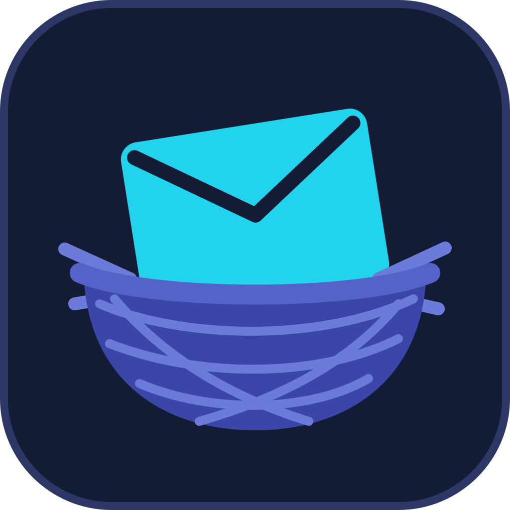

<!-- Part of DreyMail, a modified version of Ratatoskr (https://github.com/magnuspihl/Ratatoskr), AGPL-3.0-only; see LICENSE and NOTICE.
     Modified by samschultzponsys, 2026-11-13: rewritten for DreyMail (credits, quick start, releasing); upstream docs kept and rebranded.
     Modified by samschultzponsys, 2026-11-13: v1.1 status (icon, cyan accent).
     Modified by samschultzponsys, 2026-11-13: v1.2 (account colors, All inboxes switch).
     Modified by samschultzponsys, 2026-11-13: v1.3 (signatures, settings tabs).
     Modified by samschultzponsys, 2026-11-13: v1.4 (administration, sign-in settings).
     Modified by samschultzponsys, 2026-11-13: v1.5 (DreyMail's own names; upgrade notes).
     Modified by samschultzponsys, 2026-11-13: v1.6 (UI clean-up).
     Modified by samschultzponsys, 2026-11-13: v1.7 (desktop apps).
     Modified by samschultzponsys, 2026-11-13: v1.8 (Android app).
     Modified by samschultzponsys, 2026-11-13: v1.9 (Android app attached).
     Modified by samschultzponsys, 2026-11-13: v2.0 (tablets/foldables, interface size, your name, Android updates).
     Modified by samschultzponsys, 2026-11-13: v2.1 (version, update dot, changelog).
     Modified by samschultzponsys, 2026-11-15: provider compatibility (Outlook/Microsoft 365 not yet).
     Modified by samschultzponsys, 2026-11-15: v2.2 (Outlook and Microsoft 365, This device).
     Modified by samschultzponsys, 2026-11-15: v2.3 (Sign in with Google for Gmail).
     Modified by samschultzponsys, 2026-11-15: search filters and saved searches.
     Modified by samschultzponsys, 2026-11-15: roles and permissions, profile pictures, grouped settings, empty mailbox screen.
     Modified by samschultzponsys, 2026-11-15: mailbox icons.
     Modified by samschultzponsys, 2026-11-15: your own picture as a mailbox icon.
     Modified by samschultzponsys, 2026-11-15: American spelling; describes DreyMail generally.
     Modified by samschultzponsys, 2026-11-15: AI mailbox assistant.
     Modified by samschultzponsys, 2026-11-15: source code link; AI cleanup.
     Modified by samschultzponsys, 2026-11-15: AI assistant learning mode.
     Modified by samschultzponsys, 2026-11-15: copy codes, unsubscribe, block sender, mailbox health.
     Modified by samschultzponsys, 2026-11-15: send later and undo send.
     Modified by samschultzponsys, 2026-11-15: passkey sign-in.
     Modified by samschultzponsys, 2026-11-15: automatic inbox tabs.
     Modified by samschultzponsys, 2026-11-15: calendar; automatic single sign-on; credits moved to the end.
     Modified by samschultzponsys, 2026-11-15: privacy page.
     Modified by samschultzponsys, 2026-11-15: Gmail's two ways compared.
     Modified by samschultzponsys, 2026-11-15: provider list.
     Modified by samschultzponsys, 2026-11-15: connecting single sign-on to an account.
     Modified by samschultzponsys, 2026-11-17: connecting single sign-on replaces the password.
     Modified by samschultzponsys, 2026-11-17: Schedule button; longer send delays.
     Modified by samschultzponsys, 2026-11-17: pinned message buttons on every message.
     Modified by samschultzponsys, 2026-11-17: auto-replies.
     Modified by samschultzponsys, 2026-11-17: Install the app; dreymail:// links.
     Modified by samschultzponsys, 2026-11-17: v8.1 (every folder cached in the background).
     Modified by samschultzponsys, 2026-11-17: v8.2 (Settings → Storage).
     Modified by samschultzponsys, 2026-11-17: v8.3 (clear a user's mail cache; clickable flatpak notifications).
     Modified by samschultzponsys, 2026-11-17: v8.4 (single line spacing when writing).
     Modified by samschultzponsys, 2026-11-17: v8.5 (Not spam).
     Modified by samschultzponsys, 2026-11-17: v8.6 (Spam, address suggestions and bubbles, Cc/Bcc lines).
     Modified by samschultzponsys, 2026-11-17: v8.7 (Sending list under Compose).
     Modified by samschultzponsys, 2026-11-17: v8.8 (folding subfolders, on every device).
     Modified by samschultzponsys, 2026-11-17: v8.9 (the calendar as a page of its own).
     Modified by samschultzponsys, 2026-11-17: v9.0 (readable dropdown lists in dark mode).
     Modified by samschultzponsys, 2026-11-17: v9.1 (server and client versions side by side).
     Modified by samschultzponsys, 2026-11-17: v9.2 (the receiving mailbox as a colored bubble).
     Modified by samschultzponsys, 2026-11-17: v9.3 (image viewer for attached pictures).
     Modified by samschultzponsys, 2026-11-17: v9.4 (the folder bar as a real tree).
     Modified by samschultzponsys, 2026-11-17: v9.5 (calendar: full repeats, guests and invitations, Teams and Meet, reminders).
     Modified by samschultzponsys, 2026-11-17: v9.6 (stay signed in, the app lock, one copy in Sent).
     Modified by samschultzponsys, 2026-11-17: v9.7 (Gmail archive and labels, server settings in the UI).
     Modified by samschultzponsys, 2026-11-17: v9.8 (assistant: forward, reply drafts, unsubscribe, Outlook categories).
     Modified by samschultzponsys, 2026-11-18: v9.9 (importance, read receipts, printing).
     Modified by samschultzponsys, 2026-11-18: v10.0 (one short version label; the plain slide transition).
     Modified by samschultzponsys, 2026-11-18: v10.1 (follow-up flags with due dates).
     Modified by samschultzponsys, 2026-11-18: v10.2 (dragging events, show as, scheduling assistant).
     Modified by samschultzponsys, 2026-11-18: v10.3 (the company directory in address suggestions).
     Modified by samschultzponsys, 2026-11-18: v10.4 (Contacts and Tasks).
     Modified by samschultzponsys, 2026-11-18: v10.5 (shared Microsoft 365 mailboxes).
     Modified by samschultzponsys, 2026-11-18: v10.6 (S/MIME signed and encrypted mail).
     Modified by samschultzponsys, 2026-11-18: v10.7 (meeting rooms).
     Modified by samschultzponsys, 2026-11-18: v10.8 (proposing a new time).
     Modified by samschultzponsys, 2026-11-18: v10.9 (Gmail labels in the list; this and following for every calendar).
     Modified by samschultzponsys, 2026-11-18: v11.0 (Gmail "Allow" takes effect at once).
     Modified by samschultzponsys, 2026-11-18: v11.1 (pinned folders flat in your order; unread out of sight stands out and flashes).
     Modified by samschultzponsys, 2026-11-18: v11.2 (no ⌄ line when every folder is pinned).
     Modified by samschultzponsys, 2026-11-18: v11.3 (mark a folder all read; the open mailbox at the top of the bar).
     Modified by samschultzponsys, 2026-11-19: v11.4 (Android: the mailbox's icon on the left of notifications, as conversations).
     Modified by samschultzponsys, 2026-11-19: v11.5 (the icon on each side of Android notifications, group icons).
     Modified by samschultzponsys, 2026-11-19: v11.6 (Android Back stays within the mailbox you are in). -->
<p align="center"></p>

# DreyMail

*Pronounced "DRAY-mail". A drey is a squirrel's nest.*

A self-hosted webmail portal for Gmail, Outlook / Microsoft 365, Purelymail and any other IMAP/SMTP
account, in the browser, as desktop apps for Linux and Windows, and as an Android app.

## Status

Current version: **11.6**. A fast three-pane mail client with its own look (a cyan envelope in an
indigo drey), per-account colors that recolor the whole app, an on/off switch for "All
inboxes", signatures per account or shared, administration (users, OIDC sign-in) in the app, and desktop
apps for Linux (flatpak, deb, rpm) and Windows, and an Android app with instant, end-to-end
encrypted notifications that sound and look different per account, and point-and-click search
filters with saved searches, roles with permission flags, a calendar that brings together DreyMail's own shared calendars with Google, Outlook and CalDAV calendars, sends and answers invitations (with Teams or Meet meetings) and reminds you before events, and an optional [AI mailbox
assistant](#ai-mailbox-assistant) that sorts mail by rules you write in plain language. What's planned is in
[`ROADMAP.md`](ROADMAP.md). This README is updated with every change.

## What it does

A simple, good-looking, self-hosted webmail client for **any IMAP/SMTP account**.

- **Your mail server stays the source of truth.** DreyMail keeps users, their encrypted account
  settings and preferences (plus, for notifications, push subscriptions and the newest INBOX UID
  already notified about, and for snoozed mail, folder, UID and wake-up time) in one SQLite file.
  To be quick, it also keeps an encrypted, disposable copy of the newest mail of every folder in a
  second one, filled in the background as soon as a mailbox is added; see [Mail cache](#mail-cache).
- **One container.** Configured by environment variables, with a volume for the SQLite files. No
  Redis, no Postgres, no sidecars.
- **Modern UI.** Clean three-pane layout, first-class dark mode, usable on a phone.
- **Every email is treated as hostile.** See [Security model](#security-model).

## Features

- Several IMAP/SMTP accounts per user (host, port, TLS/STARTTLS, credentials, separate SMTP
  settings, display name, color). Connections are tested when you save. Passwords are encrypted
  at rest (AES-256-GCM) and never sent back to the browser.
- Login with a username and password, with any OpenID Connect provider (Authentik, Keycloak, …),
  or both side by side; see [Login](#login). Each user owns their own accounts, with strict
  per-user isolation.
- **Passkeys:** sign in with your fingerprint, face, device PIN or a security key instead of a
  password (Settings → Profile → Passkeys). Passkeys need DreyMail on https at the address in
  `DREYMAIL_BASE_URL`. They work in current browsers. In the desktop and Android apps, support
  depends on the system (Windows Hello works; Linux and Android WebView vary), and passwords or
  OIDC keep working there.
- **Stay signed in and the app lock** (Settings → This device): *Stay signed in on this device*
  keeps the sign-in for as long as DreyMail is used there at least once a month (up to a year;
  otherwise a sign-in lasts 14 days). *Lock DreyMail* after 1 minute to 4 hours without use (or
  *Lock now*): the lock screen covers everything until you unlock with one of your passkeys. The
  server keeps the lock, so reloading or reopening the app doesn't get past it; only your own
  keys, clicks and touches count as use, not the app refreshing in the background.
- **Administration in the app, with roles.** Every user has a role made of permission flags:
  - **Superadmin** has every right, including ones added in later versions. The first user is
    Superadmin, and so is anyone named in `DREYMAIL_ADMIN_USERS`.
  - **User** is the default for new users: they can use DreyMail fully, but not administer it.
  - **Your own roles** (Settings → Roles) can have any mix of flags: managing their own
    mailboxes, changing their own profile picture, managing users, changing anyone's picture,
    giving roles, sign-in settings, Microsoft/Google setup, Android setup, and seeing new versions.

  Nobody can grant rights they don't have themselves, and only a Superadmin can make or change a
  Superadmin. You also choose which role new users get. Settings shows the administration tabs
  only to roles that allow them. Settings → Users lists everyone and adds users, gives roles,
  resets passwords, changes pictures and removes users. Settings → Storage shows the space each user
  takes up, largest first: their mail cache per mailbox (folders, messages, message lists and kept
  message content) and their own data (mailboxes and settings, pictures, calendar, scheduled mail, AI
  assistant), plus the size of `dreymail.db` and `cache.db` on disk. It also clears a user's mail
  cache, for one mailbox or all of them; it fills again in the background the next time they use
  DreyMail (the freed space is reused; the file itself doesn't shrink). Settings → Sign-in sets up OIDC (with a connection test),
  password login and who may register, without a restart. Any of these given as environment
  variables in the compose file win and show as locked in the UI.
- **Accounts that feel separate.** Each account has its own color: the first one gets DreyMail
  cyan, and you can pick from presets or any color on the color wheel. While an account is open,
  the whole app takes on its color (buttons, highlights, unread dots, a light tint on the page),
  so you always know which mailbox you're in. Button labels and accent text automatically stay
  readable for any color, in light and dark mode. Each mailbox can also have an **icon**
  (briefcase, house, cart, plane… 38 to choose from) shown in its color in the sidebar and on its
  notifications in the desktop app, the Android app (status-bar and large icon) and browsers. Or
  upload your own picture, also right while adding the mailbox: size it, drag it into place, and put it
  on a transparent, white or black background. **Use Gmail's icon** (or Outlook's, Yahoo's, your
  provider's…) fetches the provider's own icon from its website into the same editor. When the
  address doesn't say which provider it is (your own domain, say), pick one from **Icon of a
  provider…** (Gmail, Outlook / Hotmail, MSN, Yahoo, AOL, Purelymail and more) or choose **Another
  website…** and type its address. When a site turns servers away, the icon comes from the public
  favicon services (Google's, then DuckDuckGo's; only the domain is sent). DreyMail doesn't ship
  other companies' logos.
- **Mailbox groups** (Accounts → Groups): put mailboxes in groups such as Work and Personal. Each
  group is a section in the sidebar that expands and collapses, with its own icon, color and total
  unread count. Optionally its mailboxes take the group's color and icon, and one switch turns
  new-mail notifications off for the whole group.
  A group's icon can be any a mailbox can have: a built-in icon, your own picture, or a provider's
  or website's icon. Right-click a group's name to edit it, or the empty space at the bottom of the folder bar
  for *New group…*.
- **Profile pictures.** Upload a picture and place it in the circle (drag and zoom; it's resized in
  the browser). Without one, DreyMail shows your Gravatar (fetched by the server, so Gravatar never
  sees your browser), or your initials in a circle filled with the app's current color. The User role may change its own picture; a role flag
  turns that off, and another lets administrators change anyone's.
- The bottom left shows your photo and name, the name only, or the photo only (Settings →
  Profile). The sidebar collapses to a slim rail of icons, showing only your picture at the bottom.
- **Settings in three groups:**
  - **This device:** stored in this browser or app only.
  - **Your account:** applies on every device.
  - **Administration:** only the tabs your role allows.
- Unified "All inboxes" view across all accounts (merged by date, paginated with per-account
  cursors). It can be turned off in Settings to keep accounts completely apart; DreyMail then
  opens on your first account. Per-account folder trees with unread counts. Live updates via IMAP
  IDLE pushed over one WebSocket per browser session.
- Message list with sender, subject, snippet, date, unread/flagged/answered/attachment
  indicators, and an account color tag in the unified view.
- **Pinned folders:** hover a folder in the sidebar and click the pin. Once a mailbox has pinned
  folders, it shows just those, as one flat list wherever they sit in the folder tree (a subfolder
  shows the folder it lives in after its name); drag them into the order you want. The line with
  the ⌄ under them shows all its folders, and ⌃ folds them away again; with every folder pinned,
  that line goes away.
- **Folder menu:** right-click a folder (long-press on a phone) to mark everything in it read, or
  to pin or unpin it.
- **The open mailbox at the top:** the top of the folder bar shows the open mailbox's icon (its
  group's, when the mailbox is just a color dot) and name with the folder below it, changing as you move around (DreyMail's own mark in All inboxes).
- **Unread out of sight:** unread mail in folded or unpinned folders shows as a filled, accent-colored
  bubble on the folder it is folded under (or on the ⌄ line), and the bubble flashes for two minutes
  when new mail arrives there.
- **Folding subfolders:** the arrow before a folder that has subfolders folds them away (their
  unread mail then counts on that folder) and back. Inbox, Sent and the other built-in mailboxes
  fold like any folder, with their subfolders listed right under them; Gmail's built-in mailboxes
  sit at the top level, so folding "[Gmail]" never hides Sent or Drafts. Collapsed mailboxes and
  groups stay collapsed on that device. What is folded is saved with your account, so
  every browser and the desktop and Android apps show the same, and open ones follow at once.
- **Reading toolbar:** the arrow at its right end switches between compact icons and bigger buttons
  with their names (kept per device). Every opened message (on its own or in a conversation) also has small
  buttons of its own (Reply, Reply all, Forward and Delete by default; Settings → General picks which, from those
  plus Mark read/unread, Flag and Archive) that act on that message only.
- **Drag to rearrange** the sidebar: groups among groups, mailboxes among mailboxes, and a
  mailbox onto a group's name to put it in that group (or onto "Not in a group", which shows while
  dragging, to take it out). Saved for your account, on every device.
- **Right-click a mailbox's name** in the folder bar (web and desktop app) to edit the mailbox
  (name, color, icon, conversations…), collapse or expand it, show all its folders, or open its AI
  assistant.
- Per mailbox (Accounts → edit): **Conversations** or **Single messages**, where every message is its
  own row, replies included.
- Conversations, Gmail-style: a message and its replies are one row ("Ada, me 3") and are read
  together, older messages folded. Your replies are found in the Sent folder, also when you
  sent them from another mail client. Messages belong together when they share Message-IDs
  (References / In-Reply-To) and their subjects match apart from "Re:" and the like. Actions on
  a conversation apply to all its messages in the folder; the copies in Sent are left alone.
- Reading plain text and HTML, with inline (`cid:`) images and attachment downloads. Remote
  images are blocked by default; "Load images" has the server fetch them and embed them in the
  message, so the sender never sees your IP address. "Always load from example.com" adds the
  sender's domain (and its subdomains) to a per-user list whose mail loads images automatically;
  manage the list in Settings. Settings → Images also loads images by themselves in mail from your own
  domains (exactly them; public ones like gmail.com don't count) and from people you have written to (both on by default), and, if you switch it on, when
  every image is on the sender's own domain. Mail that fails the sender check (DMARC) never does.
- Contact pictures instead of initials, from Gravatar, Libravatar (including a domain's own
  federated server) or, for senders at a company rather than a free mail provider, the icon of
  their website. Like remote images, the server fetches them, so these services never see your
  IP address or when you read a message. Turn them off in Settings.
- Mark read/unread, flag, move, archive, delete (to Trash, expunge only from Trash), multi-select.
  On Gmail, Archive moves mail to All Mail (taking off the Inbox label), as Gmail itself does, and
  never makes an "Archive" label.
- **Importance and read receipts:** the composer's ! and ↓ buttons send a message with high or low
  importance (shown in the message list and the reader for mail you get), and the ✓ envelope asks
  for a read receipt. A message that asks for one shows *Send receipt* / *Don't send*; nothing is
  sent unless you say so, and either answer is remembered on the message.
- **Signed and encrypted mail (S/MIME):** Settings → General → *Import…* your certificate (.p12 /
  .pfx with its key) per mailbox. Mail encrypted to you then opens like any other, and the
  composer's signature and lock buttons sign and encrypt what you send (encrypted to every
  recipient and to you, so the copy in Sent stays readable). Signed mail you receive is checked
  by itself: the reader says whether the signature matches the message, whether the certificate is
  from a known authority, in date and for the sender's address, or what is wrong. Senders'
  certificates are kept from their signed mail, which is what lets you encrypt to them. Keys are
  stored encrypted; RSA certificates (what S/MIME certificates use).
- **Shared mailboxes (Microsoft 365):** under Accounts, an Outlook mailbox signed in with Microsoft
  has *Add a shared mailbox…*: type the shared mailbox's address (support@, info@…) and it opens as
  a mailbox of its own with your sign-in, with its own folders, color and notifications. Mail you
  send from it goes out as the shared address. Your account needs Full Access to it, and Send As
  (or Send on behalf) to send from it; an administrator gives both in the Exchange admin center.
  Removing your mailbox removes its shared mailboxes from DreyMail.
- **Contacts** (button under Calendar, `/contacts`): DreyMail's own contacts together with Outlook
  contacts and Google Contacts of mailboxes where you allow them (*Allow* at the top of the page;
  it signs in to that mailbox again asking for the permission). Search, add (choosing where to save),
  edit and delete; a click on an address writes to it. DreyMail's own contacts are also suggested
  when you type an address.
- **Tasks** (`/tasks`): DreyMail's own task lists next to Microsoft To Do and Google Tasks lists
  where allowed. Type a task and press Enter (optionally with a due day), tick it off, open it for
  its due day and notes; done tasks fold away. Overdue tasks are red.
- **Company directory:** for Microsoft 365 and Google Workspace mailboxes, address suggestions can
  include the organization's people (Settings → General → *Allow* per mailbox, which signs in again
  asking for that permission). They are marked *Directory*; the server searches after two letters
  and never holds up the usual suggestions. Google needs the People API turned on in the Google
  Cloud project.
- **Follow up:** the flag-with-a-date button in the reading toolbar flags a message for follow-up
  Today, Tomorrow, This week, Next week, at a date and time, or with no date (Outlook's choices).
  The message list shows "Due …" (red once overdue), the message says "Follow up by …" with
  *Mark complete*, and at the due time a reminder comes on every device and in the reminder window
  (opening the message, with *Complete*). The flag is the mail server's own, so other apps see it;
  unflagging or deleting the message ends the follow-up.
- **Print:** the Print button in the reading toolbar prints the message with its header.
- **Gmail labels:** the message list shows each Gmail message's other labels as small tags; a
  Gmail message shows its labels under the header; × takes one off and *Add
  label* puts one on, so a message can be in several labels (each one a folder in DreyMail).
  On touch screens, swipe a message left or right to delete, archive, mark read/unread or flag it
  (which action each direction does is set in Settings).
- "Unread only" filter for the current view. Messages you read there stay on screen until you
  change the view or refresh, so the list doesn't jump under your finger.
- Snooze: hide a message until a date and time you pick (or Later today / Tomorrow / This weekend /
  Next week). See [Snooze](#snooze).
- **Signatures**, in Settings → Signatures: rich text (bold, italic, links), each with checkboxes
  for the accounts that use it. Tick one account for a per-inbox signature, or several to share
  one. Optionally also added to replies and forwards. The composer puts it in below where you
  type (above any quoted message), swaps it when you change the From account, and takes on the
  From account's color. **Import from Outlook files** takes a signature made for Outlook (the .zip
  a signature tool gives you, or its .htm file and pictures) with its table layout and pictures,
  animated GIFs included (up to 1.5 MB). Pictures in a message, a signature's included, are sent as
  inline attachments, which every mail app shows.
- **Attached pictures** (PNG, JPEG, GIF, WebP, AVIF, BMP) open with a click in an image viewer:
  arrows or ← → between the pictures of a message, Download, Esc to close. The arrow at the end of
  their chip downloads straight away. Other files, and SVG pictures (which can carry scripts),
  download with a click as before.
- Compose, reply, reply-all, and forward (with the original attachments). Includes a light
  rich-text editor, an automatic plain-text alternative, attachments, drafts (saved to the
  account's Drafts folder), and a copy in Sent. Addresses turn into bubbles as soon as they are
  complete (space, comma, Enter or leaving the field; Backspace edits the last one). While you
  type, DreyMail suggests people you have written to and people who wrote to you (not newsletters
  or no-reply senders), those you write to most first, from all mailboxes or, in Settings →
  General, only the mailbox you write from, its group or chosen mailboxes. The list is built from
  the mail cache (existing mail too) and kept per mailbox in the database. The Cc and Bcc lines show
  by themselves or a click away: Cc shown and Bcc hidden by default, set for all mailboxes, per
  group or per mailbox in Settings → General, or with the pin at the end of the line while writing. Special-use folders (`\Sent`, `\Drafts`, `\Trash`, `\Archive`, `\Junk`) are detected
  with name fallbacks.
- `mailto:` links open a new message in DreyMail: in plain-text mail directly, in HTML mail in a
  new tab (clicks inside the sandboxed message frame can't be caught). Settings → "Open email links
  with DreyMail" makes the browser send `mailto:` links on any website here too; the installed app
  (PWA) registers for them on its own where the browser supports it. Only recipients, subject and
  a plain-text body are taken from a link, and nothing is sent until you press Send.
- Search without query syntax. Type words in the search box, or open the filter panel (the
  sliders button) and pick what you want:
  - **Look in:** this folder, all inboxes, or all mail (Gmail's All Mail; on other servers, every
    folder except Trash, Junk, Drafts and Snoozed).
  - **Accounts:** one or several, by their colors.
  - **From and To,** with suggestions from people you've written to.
  - **Subject has** and **Message has.**
  - **Date:** today, the past week, month or year, or dates you choose.
  - **Size:** over 1, 5, 10 or 25 MB.
  - **Has attachment, Starred, Replied to.**

  Active filters show as chips under the search box; click one to remove it. **Save search**
  keeps the search in the sidebar as a smart folder that is re-run each time you open it, so
  "past week" always means the past week. The IMAP server does the searching; DreyMail keeps no
  index of your mail.
- **Inbox tabs:** Personal, Updates and Newsletters, sorted automatically from the mail's own
  headers without AI, each with an unread count. Switch them off in Settings → General.
- **One-time codes:** sign-in and verification codes get a copy button, on the message row and in
  the open message.
- **Unsubscribe** with one click on mailing-list mail (DreyMail does it for you where the sender
  supports it). **Block sender** sends an address or a whole domain to Junk, now and in future;
  manage blocked senders in Settings → General. In Junk, **Not spam** (in the message's toolbar,
  or for selected messages in the list) moves mail back to the inbox, marks it as not junk for the
  server's spam filter (`$NotJunk`, where the server keeps such marks; Gmail learns from the move
  itself), and unblocks the sender if you had blocked them. Everywhere else, **Spam** does the
  opposite: to Junk (made if the mailbox has none), marked `$Junk`.
- **Auto-replies** (Settings → Auto-replies): out of office, out sick, on leave, on vacation
  or your own, each for all mailboxes or for chosen mailboxes and groups, optionally from one
  date and time until another. Your server sends them, even with DreyMail closed. Each sender
  gets one at most once per interval (4 days by default), and mailing lists, newsletters, other
  automatic mail, spam-flagged mail and no-reply addresses never get one (RFC 3834); replies are
  marked as automatic so other auto-responders don't answer them.
- **Schedule** (next to Send): in 1 or 3 hours, this evening, tomorrow morning or afternoon,
  Monday morning, or any date and time. **Send delay (undo send)**: Send waits 10 seconds by
  default, with an Undo button; Settings → General offers Off, 10 s, 30 s, 1, 2 or 5 minutes, or a
  custom delay up to 10 minutes. Your server
  sends both, even if you close DreyMail. Mail in its send delay shows under **Sending**, right
  below Compose, with a countdown, **Undo** (stops it and opens it again, attachments included)
  and **Send now**, so it can be taken back after leaving it too. Mail scheduled for later is
  listed under **Scheduled** in the sidebar.
- **Calendar** (its own button under Compose; a page of its own at `/calendar` that fills the
  window like mail, back to mail with any folder or Back): month, week, day and agenda views, with every calendar in one list
  and a checkbox to show or hide each one.
  - **DreyMail's own calendars:** as many as you like, each with its own color, kept under "My
    calendars" or grouped under one of your mailboxes. Events have a title, a time or all day, a
    location, notes, a reminder and guests. **Share** a calendar with other users of your DreyMail,
    to view or to edit; it shows up for them under "Shared with me".
  - **Google and Outlook calendars** of mailboxes added with Google or Microsoft sign-in appear under
    that mailbox by themselves. They are read live and changes go straight back, so they stay the
    same as on your phone. Mailboxes added before 3.9 ask to be reconnected once to allow calendar
    access.
  - **CalDAV calendars** (Nextcloud, iCloud, Fastmail, Radicale, Baïkal and others): *Connect
    CalDAV* with the server address, username and an app password; DreyMail finds the calendars.
    Add, change and delete events, repeating ones included.
- **Repeating events:** daily, weekly, monthly or yearly, every N days, weeks, months or years;
  weekly on any set of weekdays (one click for Monday to Friday); monthly or yearly on the same day,
  on the n-th weekday ("the second Tuesday") or on the last one; forever, until a day, or a number
  of times. The editor says the rule in words ("Every 2 weeks on Monday, Wednesday, 10 times").
  Opening one occurrence asks what a change or a deletion applies to: **This event**, **This and
  following** or **All events**, for DreyMail's own, Google, Outlook and CalDAV series alike (this and
  following ends the series before that occurrence and starts a new one with the changes); a provider series with a rule the editor can't show (for example "the first weekday of
  the month") keeps its rule, and its single occurrences can still be changed.
- **Guests and invitations:** add guests (with suggestions from the people you write to), mark
  them optional, and see who accepted, might come, declined or hasn't answered. For Google and
  Outlook calendars, Google and Outlook send the invitations, updates and cancellations. For
  DreyMail's own and CalDAV calendars, DreyMail emails standard invitations (iTIP, with the time
  zone) from the mailbox you pick under *Invite from*; changes send updates, removed guests and
  deleted events get cancellations, and guests' answers that arrive in your mail are added to the
  event when you open them.
- **Teams and Meet meetings:** for an Outlook calendar of a work or school Microsoft 365 account,
  *Add a Teams meeting* makes the Teams meeting with the event, and Outlook puts the join link in the
  invitation. Google calendars offer *Add a Google Meet video call* the same way. Events with a
  meeting link (Teams, Meet, Zoom, Webex, GoTo, Whereby, Jitsi, also pasted into Location or Notes)
  get a **Join** button.
- **Moving events:** in the week and day views, drag an event to another time (15-minute steps)
  or another day. One occurrence of a repeating event moves on its own; guests get the update.
- **Show as:** Busy, Free, Tentative, Away or Working elsewhere, as in Outlook (kept in Outlook,
  Google as busy/free, and CalDAV); free and tentative events look lighter in the calendar.
- **Meeting rooms:** *Book a room* in the event editor lists the rooms you can book, each marked
  free or busy at the meeting's time; picking one invites it as a room (it accepts or declines by
  itself, shown as Booked or Not available) and fills in the location. Rooms come from Microsoft
  365 (*Allow* rooms for an Outlook mailbox; an administrator approves that permission once for the
  whole organization) and from the list an administrator keeps in Settings → Server → Meeting rooms
  (any room calendar, Google Workspace's included). Rooms show in the scheduling assistant too.
- **Scheduling assistant:** with guests on an event, *Show the scheduling assistant* lays the day
  out as a timeline with you and each guest on a row and busy times filled in: yours from your
  calendars, colleagues' from Outlook / Microsoft 365 (their free/busy) or Google (calendars shared
  with you, or your Workspace). It says when someone is busy at the chosen time; click a free spot,
  or *Next free time*, to move the meeting there (working hours, weekdays).
- **Reminders:** every event can have a reminder (none, at the start, 5 minutes up to a week
  before; new events get 15 minutes, as in Outlook). Google and Outlook events use the reminder set
  there. When the time comes, the server sends a notification to every device (the desktop app,
  the Android app and browsers with notifications on), so it arrives even with DreyMail closed, and
  the app shows a **reminder window** with Join, Snooze (5 minutes to a day, or until it starts),
  Dismiss and Dismiss all. Snoozing or dismissing on one device does it on all of them.
- **Invitations you receive:** a message with a calendar invitation shows a card with what, when,
  where and who, and **Yes / Maybe / No**. Gmail and Outlook mailboxes signed in with Google or
  Microsoft answer through their own calendar, which tells the organizer. Other mailboxes email the
  standard answer (iTIP) to the organizer from that mailbox and put the event in the calendar you
  pick (a DreyMail, Google, Outlook or CalDAV calendar), with its repeats and a 15-minute reminder.
  Canceled invitations say so and offer to remove the event. *Propose a new time* answers Maybe or
  No with another time and a note: through Outlook for Outlook mailboxes, by email (iTIP COUNTER,
  which Outlook and others understand) for the rest.
- **Proposals for your events:** when a guest proposes a new time for an event you organize, the
  message offers *Accept proposal* (the event moves and every guest gets the update, also for
  Outlook and Google events) or *Decline* (the guest is told the original time stays).
- **Mailbox health:** a mailbox with a problem, such as an expired sign-in or an unreachable
  server, shows a warning in the sidebar with a link to fix it.
- Dark mode that follows the system, with a manual override. Simple HTML and plain-text mail get
  dark styling. Heavily designed mail (newsletters) is shown on a light "paper" card instead of
  being force-inverted, with a per-message toggle.
- Notifications for new mail on phones and desktops (Web Push), and an unread badge on the app
  icon. Install DreyMail as an app (PWA) from the browser; see [Notifications](#notifications).
- On phones, a floating Compose button sits on the message list. Compose writes from the account
  you're in (the first account in "All inboxes"); the From menu switches it.
- **Pane widths:** drag the grip on the right edge of the message list (tablets and PCs) or of the
  folder bar (PCs) to make it wider or narrower; each device remembers its own widths (double-click
  the edge to reset).
- **Phones, tablets and foldables.** Phones show one pane at a time. Tablets and unfolded
  foldables show the message list on the left and the open message on the right, with the
  folders in a slide-in drawer. Desktops show all three columns.
- **Settings → This device** gathers everything that belongs to the device you're on: which app
  and version it is, updates, server address, interface size, this device's notifications and
  email links. Every other tab is your account and applies on all your devices.
- **Interface size** per device (Settings → This device): Automatic is larger in the Android app and
  follows the phone's font size; or pick 90–150%.
- **Privacy page** at `/privacy`, describing what a DreyMail server keeps and what leaves it, for
  the privacy policy link Google and Microsoft ask for. It's linked next to Source code.
- **Your name** (Settings → General) is shown at the bottom left (first name only unless you tick
  "Show my full name"); typed in lower case it is capitalized for you.
- **Version and what's new.** Under your name, the server's version (e.g. "10.0"); click it for
  the changelog. When what you use is out of step with the server it turns red with a "!": the
  tooltip says which side to update (the server's image when an app is newer, the app when it is
  older, or the page when it was left open across a server update) and a click does what it can
  (checks for the app's update, or reloads the page). When a newer image is released, Superadmins
  (and roles allowed to see new versions) see a blinking dot on it and the changelog says how to
  update (redeploy the stack in Arcane). The server checks GitHub at most every 6 hours;
  `DREYMAIL_UPDATE_CHECK=false` turns that off.
- **Phone transitions** (Settings → General → Screen transitions): the new view slides in when you
  open the menu or a message (the default), or a squirrel runs across and pulls it in, at three
  speeds; or off.
- Keyboard shortcuts: `j`/`k` to move, `r` reply, `a` reply all, `f` forward, `e` archive,
  `b` snooze, `#` delete, `s` flag, `u` mark unread, `c` compose, `Ctrl/Cmd+Enter` to send.

## Which mail providers work

DreyMail signs in to your mail server with IMAP and SMTP using a username and password (or an
app password). Under *Add account → Other email*, pick your provider from the list and the server
settings are filled in (typing your address picks it by itself): iCloud, Yahoo, AOL, Fastmail,
Purelymail, Proton Mail (Bridge), Zoho, mailbox.org, Posteo, Migadu, Runbox, Disroot, GMX, WEB.DE,
mail.com, Yandex, Xfinity, AT&T, Namecheap, Hostinger, IONOS, Infomaniak and Gmail (app password),
with a note where a provider needs something extra, like an app password. *Custom* takes any other
server. Anything that allows IMAP and SMTP works:

| Provider | Works? | How |
| --- | --- | --- |
| Purelymail, Fastmail, Migadu, mailbox.org, Proton (via Bridge), your own server | ✅ | Your normal password (or the provider's app password) |
| Gmail / Google Workspace | ✅ | Either **Add account → Gmail: Sign in with Google** (after the one-time setup below), or an **app password** (needs 2-Step Verification) |
| iCloud Mail | ✅ | An **app-specific password** from your Apple account |
| Yahoo, AOL | ✅ | An **app password** |
| **Outlook.com, Hotmail, Live** | ✅ | **Add account → Outlook / Microsoft 365**: you sign in on Microsoft's own page |
| **Microsoft 365** (work/school Outlook) | ✅ | The same button. Some organizations require their IT admin to approve the app once |

Microsoft no longer accepts passwords from mail apps, so Outlook accounts use Microsoft sign-in
(OAuth): DreyMail never sees the password. Mail is read over IMAP with a Microsoft access token
and sent through Microsoft Graph, which works even where an organization has switched off SMTP
sending, and Microsoft keeps the copy in Sent. The sign-in is stored encrypted and renewed
automatically.

**Gmail: two ways.** *Add account* offers both, side by side:

| | Sign in with Google | App password |
| --- | --- | --- |
| Google Calendar in DreyMail | ✅ edited both ways | ❌ (DreyMail's own calendars still work) |
| Answering invitations | Through Google Calendar | By email |
| Setup | One-time, by an administrator (below); the note goes away once it's done | None; create an app password at Google |
| Needs 2-Step Verification | No | Yes |
| After changing your Google password | Keeps working | Stops; make a new app password |
| Sign-in screen | Google shows an "unverified app" notice | — |

Both read mail over IMAP and send over SMTP. To switch an existing Gmail from an app password, add it
again with Sign in with Google, then remove the old entry in Accounts (nothing changes at Google).

**Sign in with Google** setup (optional; app passwords keep working): Settings → **Google** walks you
through creating a free OAuth client in Google Cloud (about 10 minutes). Publish the app there, or
Google ends the sign-in every 7 days; as it's your own unverified app, Google shows a "hasn't
verified this app" screen once (*Advanced → Go to DreyMail*). Google asks for a privacy policy before
you can publish: DreyMail has one at `/privacy` (e.g. `https://mail.example.com/privacy`); add your
own domain under *Authorized domains* and leave the logo empty. For the calendar, also turn on the
**Google Calendar API** in the same project (*APIs & Services → Library*). Compose overrides:
`DREYMAIL_GOOGLE_CLIENT_ID`, `DREYMAIL_GOOGLE_CLIENT_SECRET`.

**Outlook one-time setup** (administrator, about 5 minutes, free): Settings → **Outlook** walks you
through registering DreyMail in Microsoft's Entra admin center and pasting two values (people
allow mail and calendar access themselves when they sign in). Choose a 24-month client secret and
enter its expiry date: DreyMail puts a reminder to renew it in every Superadmin's calendar, two
weeks before it expires. Or set them
in the compose file, which then wins over the UI: `DREYMAIL_MICROSOFT_CLIENT_ID`,
`DREYMAIL_MICROSOFT_CLIENT_SECRET` and optionally `DREYMAIL_MICROSOFT_TENANT` (`common` by
default).

## AI mailbox assistant

An optional assistant that sorts mail by **rules you write in plain language**, using an AI service
you choose: a cloud service with your own API key, or a model on your own hardware so your mail
never leaves your network. Open it with the ✨ button next to a mailbox in the sidebar.

> **AI can make mistakes.** The assistant acts on your mail (moving, labeling, archiving, deleting)
> according to your rules, and an AI can misread a message or pick the wrong rule. **You use it at
> your own risk.** Test rules first and check the History tab; most actions can be undone there.
> DreyMail shows this notice before first use.

**How it works:**
- **Changes happen in your mailbox.** Folders, labels, moves and flags are made on Gmail, Outlook or
  your IMAP server, so every app sees them.
- **DreyMail does the thinking.** It evaluates the rules, keeps the history and stores your keys
  (encrypted). No mail is stored.
- **It runs on its own.** New mail is sorted as it arrives, before any notification, even while
  DreyMail isn't open in a browser.

**Who can use it:** the role permission *Use the AI mailbox assistant*, which the built-in User
role doesn't have; add it in Settings → Roles. Or switch it on or off for one person in Settings →
Users. *Set up shared AI connections* lets administrators add a connection everyone allowed may
use (they never see its key), including servers on the local network.

### Setting up an AI connection

Settings → **AI connections** (or **Add AI connection** in the assistant): pick a service, paste a
key, pick a model (**Load models** lists what the service offers), **Test**, save. Then tick the
mailboxes that should use it. One connection can serve all mailboxes, or each mailbox can have its
own.

| Service | Get a key | Models to try for sorting mail |
|---|---|---|
| Anthropic (Claude) | [console.anthropic.com](https://console.anthropic.com/settings/keys) → API keys | `claude-haiku-5-5`: fast and very inexpensive, recommended. `claude-sonnet-5-5` for tricky rules (about 20× the price). `claude-opus-5-5` is rarely needed. |
| Google Gemini | [aistudio.google.com](https://aistudio.google.com/app/apikey) → Get API key | A *Flash* or *Flash-Lite* model |
| OpenAI (ChatGPT) | [platform.openai.com](https://platform.openai.com/api-keys) → API keys | A *mini* or *nano* model |
| DeepSeek | [platform.deepseek.com](https://platform.deepseek.com/api_keys) | `deepseek-chat` |
| Mistral, Groq, xAI | their consoles | a small / fast model |
| OpenRouter (many providers, one key) | [openrouter.ai](https://openrouter.ai/keys) | any small model (*mini*, *flash*, *haiku*) |
| **LM Studio** (local) | no key | any instruction model you've loaded; 7–14B models sort mail well |
| **Ollama** (local) | no key | e.g. a 7–14B instruct model you've pulled |
| vLLM, llama.cpp server, LocalAI, … | usually none | anything that speaks the OpenAI chat API |

**Sorting mail is a simple job:** a small, inexpensive model is usually all it takes, and large
models cost more without sorting much better.

**Local models (LM Studio, Ollama, …):**
- **LM Studio:** Developer → *Start server*; the address is `http://<computer>:1234/v1`.
- **Ollama:** listens on `http://<computer>:11434/v1`. Set `OLLAMA_HOST=0.0.0.0` if DreyMail runs
  on another machine.
- **DreyMail in Docker:** `localhost` is the container itself, not your computer. Use the host's
  LAN IP, or the container name if the model server is on the same Docker network (e.g.
  `customnetex`).
- **Who can add one:** local addresses can only be added by an administrator, as a shared
  connection, so users can't point DreyMail at other machines on your network.

**Keeping costs down:**
- Each message the AI looks at is one request, and every connection has a **daily limit** (500 by
  default).
- Rules with only exact conditions (sender, subject…) never use the AI.
- A lower accuracy level sends less text.

### Accuracy: what the AI sees

A slider per mailbox. Hold it to see exactly what is sent. The default is Full.

| Level | The AI sees |
|---|---|
| Private | Sender and subject |
| Balanced | + recipients and the first ~300 characters |
| High | + the first ~2,000 characters |
| Full | + the whole text (up to ~12,000 characters) and attachment names |

### Rules

Built point-and-click in the **Rules** tab:
- **A name.**
- **"Which mail is this for?"** in your own words, e.g. *newsletters and marketing I didn't ask
  for, except from my bank*.
- **Optional exact conditions:** from, to, subject, attachments.
- **What to do:** move to a folder (created if needed), add a label, archive, mark read, star, move
  to Trash, mark as spam, and:
  - **Forward to** an address (with the attachments).
  - **Draft a reply (AI):** the AI writes a reply in your name, optionally following your
    instructions ("thank them and say I'll answer by Friday"), saved in **Drafts** for you to check
    and send; it never sends by itself and leaves placeholders rather than making up facts.
  - **Unsubscribe (one click):** uses the sender's one-click unsubscribe link (RFC 8058) when the
    message has one.
  - **Outlook category:** for Outlook / Microsoft 365 mailboxes signed in with Microsoft, a real
    Outlook category (click *Allow Outlook categories* once in the rule to give DreyMail permission
    to change mail); in other mailboxes it becomes a label.

Rules are checked from the top; the first that applies wins. **Test this rule** shows what it would
do with your newest messages before you save it.

**Labels by provider:**

| Provider | Labels |
|---|---|
| Gmail | real Gmail labels |
| Other IMAP servers that allow custom keywords | keywords (tags) |
| Others, including Outlook | a copy in a folder of that name; the message stays where it is |

**Test** runs all your rules over your newest 10–100 messages without changing anything; **Do it**
applies one. **History** lists everything the assistant did, with **Undo**.

**Safety:**
- The AI only ever chooses **one of your own rules**. The email's text is treated as data, so a
  message trying to instruct the AI can at worst make it pick the wrong rule, never do something no
  rule says.
- Keys are encrypted in DreyMail's database and never sent back to the browser.

### Clean up

- **Sort existing mail:** runs your rules once over the newest 50–2,500 inbox messages, with
  progress and Stop.
- **Senders:** your inbox grouped by sender, biggest first, with no AI involved. For each sender:
  - **Archive all** (undo in History).
  - **Always archive** (adds a rule that needs no AI).
  - **Unsubscribe:** DreyMail does it for you where the sender supports one-click unsubscribe;
    otherwise it opens their unsubscribe page.

### Learning mode

Not sure which rules you need? Let the assistant learn:
- **Choose a period** per mailbox: 3 days, 1 week, 2 weeks (catches weekly mail) or 1 month
  (catches monthly bills and statements). A month is the maximum; you can extend or end early.
- **While it runs:**
  - The AI notes what kind of mail each new message is. That's **one extra AI request per new
    message**, shown before you start and counted toward the daily limit.
  - DreyMail notes what you do with the mail: archive, delete, move, read, star, reply, or leave
    unread, including in other apps.
  - Learning itself sorts nothing.
- **Afterwards:** **Suggest rules** asks the AI once, with a per-sender summary rather than your
  messages. Each suggestion shows its evidence (*"You archived 4 of 4 emails from this sender
  without reading them"*) and can be accepted, edited or rejected.
- **When the period ends,** DreyMail opens the review the next time you use it.

## Quick start (Docker Compose)

DreyMail is configured with environment variables written inline in the compose file (no `.env`
file). This example is a stack as it would run under Arcane on Unraid: a bind mount, `PUID`/`PGID`
`99:100`, no published ports, and an external network shared with the reverse proxy. Adjust the
paths, IDs and network to your setup.

```yaml
services:
  dreymail:
    image: ghcr.io/samschultzponsys/dreymail:latest
    container_name: dreymail
    restart: unless-stopped
    environment:
      - PUID=99
      - PGID=100
      - DREYMAIL_BASE_URL=https://mail.example.com
      - DREYMAIL_SECRET_KEY=replace-with-a-long-random-string-of-at-least-32-chars
      - DREYMAIL_TRUST_PROXY=true
      - OIDC_ISSUER_URL=https://auth.example.com/application/o/dreymail/
      - OIDC_CLIENT_ID=dreymail
      - OIDC_CLIENT_SECRET=replace-with-the-client-secret
    networks:
      - customnetex
    volumes:
      - /mnt/nvme2tbadata/dockerstatic/dreymail:/data

networks:
  customnetex:
    external: true
```

1. Register an OIDC client at your identity provider (see [OIDC setup](#oidc-setup)), or drop the
   `OIDC_*` lines to use username/password login.
2. Generate the secret key with `openssl rand -base64 48` and set `DREYMAIL_BASE_URL`.
3. Point your reverse proxy at `dreymail:8080`, open `https://mail.example.com`, sign in, and add
   your first mail account.

Most settings can also be made in the app (Settings), and a value given in the compose file always
wins over the app and shows there as locked.

Images are published to `ghcr.io/samschultzponsys/dreymail` for every release (see
[Releasing](#releasing)), tagged with the version (`1.0`, `1.1`, …) and `latest`. You can also
build it yourself with `docker build -t dreymail .`.

The server runs as user and group `1000:1000` unless `PUID`/`PGID` say otherwise, and takes over
the data directory on start (it `chown`s it when anything in it belongs to someone else). `UMASK`
(e.g. `002`) sets the permissions of the files it creates. Starting the container with `--user`
(`user:` in Compose) also works; then it runs as that user, ignores `PUID`/`PGID` and changes no
ownership.

## Desktop apps (Linux and Windows)

**Install the app** (the download icon at the bottom of the sidebar in a browser, or Settings →
This device) picks the right download for the device (Windows, Linux, Android) with step-by-step
instructions, or explains adding DreyMail to the home screen (iPhone, iPad) or as a web app (Mac).
Right-clicking the sidebar icon hides it. **Open this page in the app** there opens the installed
desktop or Android app at the same page through a `dreymail://open?path=…` link (the browser asks
first; on Android, Chrome stays on the page when the app isn't installed). Browsers can't open an
installed app by themselves when you visit the web address, so this is a button rather than
automatic.

Every release has desktop apps attached, with the version in the file name:

| File | For | Install |
| --- | --- | --- |
| `DreyMail-1.7-x86_64.flatpak` | any Linux with Flatpak | `flatpak install --user ./DreyMail-1.7-x86_64.flatpak` (updates: the app gives you one command that downloads, installs and restarts DreyMail) |
| `DreyMail-1.7-amd64.deb` | Debian, Ubuntu, Mint | `sudo apt install ./DreyMail-1.7-amd64.deb` |
| `DreyMail-1.7-x86_64.rpm` | Fedora, openSUSE | `sudo dnf install ./DreyMail-1.7-x86_64.rpm` |
| `DreyMail-Setup-1.7-x64.exe` | Windows 10/11 | run it (it isn't code-signed yet, so Windows SmartScreen asks: *More info → Run anyway*) |

The app asks for your DreyMail server's address once (change it later under *DreyMail → Change
server…*) and then shows DreyMail in its own window:

- **Notifications in each account's color.** New mail pops up as a native notification whose
  icon is the envelope in that account's color, so you see at a glance which inbox it's for.
  Click it to open the message. Closing the window keeps DreyMail running in the tray, so
  notifications keep coming; *Quit* from the tray or menu stops it. New mail for **every mailbox**
  becomes a notification, also while the window is in front, with the mailbox's name in its title
  and its icon in its color (Settings → This device → "Send a test notification for each
  mailbox" shows them). Uploaded pictures and provider icons show in any format. In the flatpak,
  notifications go straight to the desktop's notification service, so they also show while the
  window is behind others or in the tray (KDE Plasma dropped them otherwise). **Minimize to the tray** (on
  by default; Settings → This device, the tray menu or the DreyMail menu) makes minimizing hide the
  window from the taskbar too. A click on the tray icon brings the window back and the next click
  sends it away again (on Linux desktops where a click opens the tray menu, use *Show / hide
  DreyMail* there).
- **Updates.** The app checks for a newer release every time it starts, and on demand (*DreyMail →
  Check for updates…*, the tray menu, or Settings → This device). It knows how it was installed and
  shows the exact upgrade for that: the flatpak, apt or dnf command (copied to your clipboard,
  with the download opened), or on Windows it downloads the new installer and runs it.
- Links in mail open in your normal browser; the window only shows your DreyMail server and its
  sign-in. *Help → Source code* links to this repository.

## Android app

Every release also has `DreyMail-X.Y.apk`. Download it on your phone and open it (allow your
browser to install apps when Android asks). It asks for your DreyMail server's address once.

- **Instant, per-account notifications.** Your server already watches every inbox with IMAP IDLE;
  the moment mail lands it wakes the phone through Firebase Cloud Messaging, the same way Spark
  and Gmail do. No polling, no permanent "checking mail" notification, no mail passwords on the
  phone.
- **Each account sounds and looks different.** Every account is its own Android notification
  channel: Settings → This device in the app lists them, and each one opens Android's own
  sound/vibration/importance settings. The status-bar icon is tinted in the account's color and
  the notification shows the envelope in that color. Notifications of the same account are
  grouped, tapping one opens the message, and they disappear when the mail is read elsewhere.
- **Back stays in your mailbox.** The phone's Back button closes what is open (the folder list, a
  dialog, the composer), goes from a message to its folder, and from another folder, a search, or
  the calendar, contacts or tasks to the inbox of the mailbox you are in; never into another
  mailbox. At an inbox, Back puts DreyMail in the background.
- **Pick the icons (optional).** Settings → This device sets the icon on each side of a
  notification: on the left DreyMail's own, the mailbox's, its group's or its color; on the right
  the mailbox's (default), its group's, its color or none. Anything but DreyMail's own on the left
  sends new mail as Android conversations, in the Conversations section above other apps
  (long-press one to make that mailbox a priority conversation). A mailbox that is just a color dot
  shows an envelope in its color, and the group's icon falls back to the mailbox's.
- **Private.** Notifications are end-to-end encrypted to the phone (Web Push encryption,
  RFC 8291): Google relays only ciphertext.
- **Updates built in.** The app checks for a newer release when it starts, when you come back to it
  after a few hours, and from Settings → This device. "Update now" downloads it inside the app (with a
  progress notification) and opens Android's install screen; the first time, Android asks you to
  allow DreyMail to install updates. Your login and settings stay.

**One-time setup** (administrator): create a free Firebase project and enter its values in
Settings → Android. The page walks you through it (about 10 minutes). Or set them in the
compose file instead, which then wins over the UI:
`DREYMAIL_FIREBASE_SERVICE_ACCOUNT` (the service account JSON, one line),
`DREYMAIL_FIREBASE_API_KEY`, `DREYMAIL_FIREBASE_APP_ID`, `DREYMAIL_FIREBASE_SENDER_ID`.

## Upgrading to 1.5 (new names)

DreyMail 1.5 uses its own names throughout. In your compose file, rename every environment variable
that starts with the old prefix to start with `DREYMAIL_` instead (same suffix, e.g. the
secret key becomes `DREYMAIL_SECRET_KEY`). DreyMail refuses to start with the old names and lists
each one with its new name, so nothing is silently ignored. On first start it upgrades your data
volume by itself:

- the database file is renamed to `dreymail.db`;
- stored mail passwords (and an OIDC client secret set in the UI) are re-encrypted with DreyMail's
  own keys, from the same `DREYMAIL_SECRET_KEY` value;
- the mail cache is rebuilt (it refills in the background);
- everyone signs in once more, and each device's notifications re-register by themselves the next
  time DreyMail is opened on it.

## Configuration

Settings → Administration → **Server** sets the starting values for new mailboxes
(`DREYMAIL_DEFAULT_*`), the mail cache (`DREYMAIL_CACHE*`), limits (`DREYMAIL_MAX_MESSAGE_MB`,
`DREYMAIL_MAX_UPLOAD_MB`, `DREYMAIL_IMAP_IDLE_TIMEOUT`, `DREYMAIL_BLOCK_PRIVATE_MAIL_HOSTS`), the
push contact (`DREYMAIL_VAPID_SUBJECT`) and the update check (`DREYMAIL_UPDATE_CHECK`) in the app,
stored in the database. Sign-in, Outlook, Google and Android have their own tabs. A variable set in
the environment always wins and shows there locked with its name; mailbox defaults apply at once,
the others after a restart. The secret key, data folder, address and proxy setting stay in the
environment.

| Variable | Required | Default | Description |
| --- | --- | --- | --- |
| `DREYMAIL_BASE_URL` | yes (prod) | `http://localhost:8080` | Public URL of the app. Used for the OIDC redirect URI, cookie `Secure` flag and WebSocket origin check. |
| `DREYMAIL_SECRET_KEY` | yes | – | Master secret, at least 32 characters (`openssl rand -base64 48`). Subkeys for credential encryption, session cookies and URL signing are derived from it with HKDF. **If you change it, stored account passwords can no longer be decrypted.** |
| `DREYMAIL_PASSWORD_LOGIN` | no | `true` without OIDC, `false` with OIDC | Username/password login. |
| `DREYMAIL_REGISTRATION` | no | `first` | Who may create a password account: `open` (anyone), `first` (only the first user of an empty instance) or `closed`. |
| `OIDC_ISSUER_URL` | for OIDC | – | Issuer URL; `/.well-known/openid-configuration` is discovered from it. |
| `OIDC_CLIENT_ID` | for OIDC | – | Client ID. |
| `OIDC_CLIENT_SECRET` | usually | – | Client secret (confidential client). |
| `OIDC_SCOPES` | no | `openid email profile` | Requested scopes. |
| `OIDC_LABEL` | no | `Single sign-on` | Provider name on the login button ("Sign in with …"), e.g. `Authentik`. |
| `DREYMAIL_OIDC_AUTO_LOGIN` | no | `false` | `true`: opening DreyMail goes straight to the OIDC provider. `/login` still shows the sign-in page. |
| `DREYMAIL_TRUST_PROXY` | no | `false` | Trust `X-Forwarded-*` headers. Set to `true` behind a reverse proxy. |
| `DREYMAIL_DATA_DIR` | no | `./data` (`/data` in the image) | Where `dreymail.db` and the mail cache `cache.db` (SQLite) live. |
| `PUID` / `PGID` | no | `1000` / `1000` | Docker image only: user and group the server runs as and that owns the data directory. |
| `UMASK` | no | – | Docker image only: umask for files the server creates, e.g. `022` or `002`. |
| `PORT` / `HOST` | no | `8080` / `0.0.0.0` | Listen address. |
| `DREYMAIL_BLOCK_PRIVATE_MAIL_HOSTS` | no | `false` | Refuse IMAP/SMTP hosts that resolve to private/internal addresses. Turn on if untrusted users can log in. Leave off if your mail server is on your LAN. |
| `DREYMAIL_IMAP_IDLE_TIMEOUT` | no | `300` | Seconds before an unused pooled IMAP connection is closed. |
| `DREYMAIL_MAX_MESSAGE_MB` | no | `50` | Largest message the server downloads for display. |
| `DREYMAIL_MAX_UPLOAD_MB` | no | `25` | Largest total attachment upload when composing. |
| `DREYMAIL_CACHE` | no | `true` | Keep a local copy of each account's newest mail, see [Mail cache](#mail-cache). `false` asks the mail server every time. |
| `DREYMAIL_CACHE_MESSAGES` | no | `2000` | Newest messages kept of INBOX and Sent (50–100000). Older mail is fetched from the mail server as you scroll. |
| `DREYMAIL_CACHE_FOLDER_MESSAGES` | no | `500` | Newest messages kept of every other folder (50–100000), filled in the background. `0` caches only INBOX and Sent. |
| `DREYMAIL_CACHE_MAX_BODY_MB` | no | `1` | Largest message whose content is kept (`0`: keep no message content). |
| `DREYMAIL_CACHE_ACCOUNT_MB` | no | `200` | Message content kept per account; the least recently read goes first. |
| `DREYMAIL_VAPID_SUBJECT` | no | `DREYMAIL_BASE_URL` if it is `https://`, else `mailto:postmaster@<host>` | Contact sent to push services (Apple, Google, Mozilla) with every notification: a `mailto:` or `https:` URL. |
| `DREYMAIL_DEFAULT_*` | no | – | Starting values for new mail accounts, see [Default account settings](#default-account-settings). |
| `LOG_LEVEL` | no | `info` | `fatal`, `error`, `warn`, `info`, `debug`, `trace`. |
| `DREYMAIL_DEV_LOGIN` | no | `false` | Development only: log in as a local dev user without a password or OIDC. Ignored when `NODE_ENV=production` (always set in the image). |
| `DREYMAIL_DEV_ALLOWED_HOST_SUFFIX` | no | – | Development only: also serve the dev server on any host ending in this suffix (see [Development](#development)). Ignored when `NODE_ENV=production` and by the production build. |

### Default account settings

If your users all get their mail from the same provider, set the server details once and the
**Add account** form starts out filled in. Users can still change every field.

| Variable | Description |
| --- | --- |
| `DREYMAIL_DEFAULT_IMAP_HOST` / `DREYMAIL_DEFAULT_SMTP_HOST` | Incoming and outgoing server. |
| `DREYMAIL_DEFAULT_IMAP_SECURITY` / `DREYMAIL_DEFAULT_SMTP_SECURITY` | `tls` (default), `starttls` or `none`. |
| `DREYMAIL_DEFAULT_IMAP_PORT` / `DREYMAIL_DEFAULT_SMTP_PORT` | Defaults to the standard port for the security mode (993/143, 465/587). |
| `DREYMAIL_DEFAULT_MAIL_USERNAME` | Username for IMAP and SMTP. |
| `DREYMAIL_DEFAULT_EMAIL` | Email address of the account. |
| `DREYMAIL_DEFAULT_DISPLAY_NAME` | Name shown to recipients. |
| `DREYMAIL_DEFAULT_ACCOUNT_LABEL` | Account label in the sidebar. |
| `DREYMAIL_DEFAULT_MAIL_PASSWORD` | Optional shared password for IMAP and SMTP. |

All of them except the password can contain tokens that are filled in for each user:

- `{username}`: the login username of password users; for OIDC users the provider's
  `preferred_username` (or, without one, the part of their email address before the `@`).
- `{email}`: the user's email address from login.
- `{name}`: the user's name from login.

If a user has no value for a token (an OIDC user without an email address, say), the field starts
empty instead. A misspelled token stops the server from starting.

```env
DREYMAIL_DEFAULT_IMAP_HOST=imap.example.com
DREYMAIL_DEFAULT_SMTP_HOST=smtp.example.com
DREYMAIL_DEFAULT_MAIL_USERNAME={username}@example.com
DREYMAIL_DEFAULT_EMAIL={username}@example.com
DREYMAIL_DEFAULT_DISPLAY_NAME={name}
```

The default password is taken literally and never sent to the browser. When a user leaves the
password blank, the server fills it in, but only for the default server: if the user points the
account at a different host, they have to enter that host's password themselves.

### Notifications

DreyMail is an installable web app (PWA) and can send notifications for new mail through the
browsers' standard Web Push services. No native app, no Firebase or Apple developer account and
no extra configuration are needed. The push keys (VAPID) are derived from
`DREYMAIL_SECRET_KEY`. HTTPS is required.

Each user turns notifications on per device in **Settings → This device**:

- **Android** (Chrome, Firefox, Edge, Samsung Internet) and **desktop browsers**: turn the switch on.
  Installing the app ("Add to Home screen" / "Install app") is optional.
- **iPhone and iPad** (iOS/iPadOS 16.4 or newer): open the site in Safari, tap *Share → Add to
  Home Screen*, open DreyMail from the Home Screen, then turn the switch on. A Safari tab can't
  receive notifications.

What you get:

- One notification per new **unread** message in any account's INBOX (several messages that
  arrive together are summarised in one). Tapping it opens the message.
- Nothing while the app is open and focused on any of your devices, since the list updates live
  anyway.
- Users choose whether notifications show **sender and subject**, **sender, subject and the start
  of the message** (up to about 1,000 characters of its text with its paragraphs, fetched when it
  arrives; expand the notification to read it), or only "New message" and the account name (Settings → This device, in the browser and the Android app). The payload is end-to-end encrypted to the device (RFC 8291), but it does pass
  through Apple's, Google's or Mozilla's push service.
- Notifications close themselves on all your devices once their messages are read or moved out of
  the inbox, in DreyMail or in any other mail client (within the 24 hours a notification is
  kept, and not across a server restart). Not on iPhone and iPad: Apple revokes notifications for
  sites that send pushes which show nothing.
- The app icon shows the number of unread messages across all inboxes, where the platform
  supports badges.
- On Android, the notification header shows the browser's icon and name unless the browser
  installs the app as a real Android app (a "WebAPK", as Chrome does). Browsers such
  as Vivaldi add a home screen shortcut instead, so their notifications are attributed to
  the browser; the squirrel still appears in the status bar and as the notification's picture.

How it works: while a user has notifications on at least one device, the server keeps one IMAP
IDLE connection per account open on INBOX, even when no browser is open. Mind your provider's
connection limits (Gmail allows 15 simultaneous IMAP connections per account). The server
remembers the newest INBOX UID it has notified about, so after a restart it reports mail that
arrived while it was down, but never old mail when notifications are switched on. Subscriptions
that the push service reports as expired are removed automatically. Signing out stops
notifications on that device.

### Snooze

Snoozing moves a message to the account's **Snoozed** folder until the time you pick. DreyMail
uses the folder the server marks as Snoozed (the IMAP `\Snoozed` attribute from RFC 9979), or a
folder named "Snoozed", and creates one if there is none. IMAP has no way to store *when* a message
should come back, so DreyMail keeps the wake-up time in its database and runs the timer itself.

When the time comes, the message goes back to INBOX as unread, with the current time as its arrival
date, so it is at the top of the list. Messages larger than `DREYMAIL_MAX_MESSAGE_MB` are moved
back as they are and keep their old date. Then:

- your devices with notifications on get a "Back from snooze" notification (same content setting
  as for new mail; nothing while the app is open and in front of you);
- open browser windows show a notice with a link to the message.

In the Snoozed folder each message shows when it comes back. Open one to **Unsnooze** it (back to
the inbox right away) or snooze it again to change the time. A snooze can be undone from the
notice that confirms it. Snoozes that came due while the server was down are handled when it
starts. A message you move out of the Snoozed folder yourself, in DreyMail or another mail app,
stays where you put it.

### Login

Two login methods are available, alone or together:

- **Username and password.** On by default when no OIDC provider is configured. With OIDC, turn
  it on with `DREYMAIL_PASSWORD_LOGIN=true`. Usernames are case-insensitive (an email address
  works); passwords need at least 10 characters and are stored as scrypt hashes. By default only
  the first person to open a fresh instance can create an account (`DREYMAIL_REGISTRATION=first`).
  To let others sign up, set `DREYMAIL_REGISTRATION=open` (for a while, or permanently on a
  private network), then back to `closed`. With open registration on a public instance, also set
  `DREYMAIL_BLOCK_PRIVATE_MAIL_HOSTS=true` so strangers can't point IMAP/SMTP at your LAN. After
  10 wrong passwords for one username, or 30 from one IP address, logins are refused for 15 minutes. Users change their password in **Settings**.
- **OpenID Connect** (Authentik, Keycloak, …): see below.

Password users and OIDC users are separate accounts, even if they share an email address.

Sessions are encrypted cookies valid for 14 days, or on devices set to stay signed in, 30 days from
the last use (at most a year from signing in). The idle lock is kept in the same cookie. They can't be revoked one by one: changing a
password doesn't sign out other devices. Changing `DREYMAIL_SECRET_KEY` signs everyone out (and
makes stored mail passwords unreadable).

### OIDC setup

Create an OAuth2/OpenID Connect application (confidential client, authorization code flow) with:

- Redirect URI: `https://mail.example.com/auth/callback`
- Post-logout redirect URI (optional): `https://mail.example.com/`
- Scopes: `openid email profile`

Settings → Sign-in shows both URIs for the address you have DreyMail open at, with Copy buttons,
and warns if that differs from `DREYMAIL_BASE_URL`.

**Already have a password account?** Signing in with OIDC makes a new, separate account, matched by
the provider's user ID. To use your existing account instead, sign in to it and choose **Settings →
Profile → Connect** (your provider's name), then sign in at the provider once. From then on, single
sign-on opens that account with its mailboxes. Connecting **replaces the password**: the account
then signs in with single sign-on (or a passkey), so it has no Password tab and administrators
can't reset a password for it. **Disconnect** undoes it and asks for a new password (optional if
the account has a passkey). DreyMail never joins accounts by email address, so nobody can take over an
account by changing their email at the provider. If you signed in with OIDC before connecting, the
empty account it made can be removed in Settings → Users.

**Sign in automatically** (Settings → Sign-in, or `DREYMAIL_OIDC_AUTO_LOGIN=true`): opening DreyMail
goes straight to the provider, with no sign-in page in between. The sign-in page with every other
option stays at **`/login`** (e.g. `https://mail.example.com/login`): use it when the provider is
down or to sign in with a password or passkey, so keep one of those for an administrator. After
signing out, DreyMail waits on the sign-in page instead of signing straight back in, and a failed
sign-in comes back to `/login` with the reason instead of trying again.

**Authentik:** create an *OAuth2/OpenID Provider* and an *Application*. The issuer URL looks like
`https://auth.example.com/application/o/<application-slug>/`. Use Authentik's application
bindings/policies to decide who may log in.

**Keycloak:** create a client with *Client authentication* on and *Standard flow* enabled. The
issuer URL looks like `https://auth.example.com/realms/<realm>`.

Anyone your provider lets through can use DreyMail. Users are identified by issuer and `sub`
claim, and each user sees only the mail accounts they added themselves. DreyMail uses PKCE,
`state` and `nonce`, and supports RP-initiated logout if the provider advertises an
`end_session_endpoint`.

### Reverse proxy notes

- Terminate TLS at the proxy and set `DREYMAIL_BASE_URL` to the public `https://` URL and
  `DREYMAIL_TRUST_PROXY=true`.
- **WebSockets** must be proxied on `/api/ws` (live updates). Nginx:

  ```nginx
  location / {
      proxy_pass http://127.0.0.1:8080;
      proxy_http_version 1.1;
      proxy_set_header Upgrade $http_upgrade;
      proxy_set_header Connection $connection_upgrade;  # map $http_upgrade, see nginx docs
      proxy_set_header Host $host;
      proxy_set_header X-Forwarded-For $proxy_add_x_forwarded_for;
      proxy_set_header X-Forwarded-Proto $scheme;
      proxy_read_timeout 1h;
      client_max_body_size 30m;   # attachments
  }
  ```

  Caddy and Traefik proxy WebSockets automatically.
- Allow request bodies at least as large as `DREYMAIL_MAX_UPLOAD_MB` (plus a little overhead).
- Serve DreyMail on its own (sub)domain, not under a path prefix.

### Mail cache

Asking the mail server for everything on every click is slow: one page of a folder takes several
IMAP round trips, and finding the rest of each conversation in the Sent folder means header
searches that some servers are slow at. So DreyMail keeps a copy of the newest messages
(`DREYMAIL_CACHE_MESSAGES`, 2000 by default) of each account's **INBOX** and **Sent** folder, and of
the newest messages of **every other folder** (`DREYMAIL_CACHE_FOLDER_MESSAGES`, 500 by default):
sender, subject, snippet, flags and the headers that tie conversations together.

The other folders are filled in the background, one at a time, as soon as a mailbox is added and
again whenever a session opens (folders not checked in the last 10 minutes; up to 100 folders per
mailbox, Drafts, Archive, Junk and Trash first). This runs on a connection of its own, so it never
holds up what you are doing. A folder you open before its turn starts filling right away. It also keeps the
content of messages you have opened, and loads the newest unread ones ahead, up to
`DREYMAIL_CACHE_MAX_BODY_MB` per message and `DREYMAIL_CACHE_ACCOUNT_MB` per account. The limits
are server settings; users can't change them.

The mail server stays the source of truth:

- Every action (read, flag, move, delete, send) goes to the mail server first; the copy is updated
  once the server has done it.
- The copy follows the server. While INBOX is watched (a browser is open, or notifications are on),
  every change reported by IDLE is fetched right away, so the inbox shows without asking the server.
  Otherwise, a listing first gives the server a moment (1.5 s) to report changes (a quick check
  that goes ahead of the background filling), and shows the copy if it is slower; the list
  updates by itself when the changes arrive. **Refresh**
  always checks with the server first. Changes are fetched incrementally: new messages, changed
  flags (only those since the last check where the server supports CONDSTORE) and messages that are
  gone. A new UIDVALIDITY starts the folder over.
- Searches, scrolling past the copy, attachments and folder counts always go to the mail server.
  Folders removed on the server are dropped from the copy.
- The copy is disposable. It is a separate file (`cache.db`), and anything wrong with it (a damaged
  file, an entry that doesn't decrypt, another secret key, a new format) just empties it, or the
  folder concerned, and it is filled again from the server. Deleting the file while DreyMail is
  stopped is always safe.

What is stored and how: subjects, addresses, snippets, Message-IDs, References and message content
are encrypted with AES-256-GCM (a key derived from `DREYMAIL_SECRET_KEY`), each entry bound to its
user, account, folder and message, so a copied row doesn't decrypt elsewhere. Conversations are
matched through keyed hashes (HMAC) of the Message-IDs, not the IDs themselves. Readable in the file
are only what queries need: folder names, UIDs, arrival times, sizes and the read/flagged/answered/
draft flags. An account's copy is deleted with the account, or when it is pointed at another server
or login.

## Security model

Every message is assumed to be hostile.

- **HTML mail** is sanitized on the server with `sanitize-html` and a `postcss`-based CSS
  sanitizer. Removed: scripts, event handlers, forms, frames, objects, SVG/MathML,
  meta/base/link, comments, `javascript:`/`data:` links, CSS expressions, `@import`,
  behaviors, and anything hidden behind CSS escapes. Links are limited to
  `http`/`https`/`mailto`/`tel` and open in a new tab with `noopener noreferrer`. `mailto:` links
  are pointed at the app's own composer (`/?mailto=…`) just before display.
- The result is rendered in an `<iframe sandbox>` **without** `allow-scripts`, so nothing in a
  message can run. (Since 6.7 the frame has `allow-same-origin`, which lets the app measure the
  message and make the frame as tall as it, so a conversation scrolls as one page; with scripts
  off, the message itself still can't reach the app, its cookies or storage.) A strict
  Content-Security-Policy inside the frame (`default-src 'none'; img-src data:`)
  blocks scripts, forms, frames and **every** network request: the rendered message never
  contacts any server, which also means it works behind cookie-based auth proxies.
- **Remote content is blocked by default.** "Load images" makes the server download the images
  (``, `background=` and CSS `url()`) and embed them as `data:` URIs, so senders never see the
  reader's IP address, cookies or referrer. The fetcher only fetches `http(s)` on ports 80/443.
  It resolves DNS itself and refuses loopback/private/link-local/CGNAT/ULA/multicast/reserved
  addresses, including IPv4-mapped IPv6 and IP literals. It connects to the address it checked
  (no DNS-rebinding window), re-checks every redirect, and only accepts raster image types (no
  SVG). Limits per message: 6 parallel fetches, 10 MB per image, 15 MB and 100 images in total,
  and a 20 s budget. Anything over a limit, failing or blocked is left out, keeping its size and
  alt text as a placeholder. Fetched images sit in a small in-memory cache (per user, 10
  minutes, 64 MB) so toggling or reopening a message doesn't download them again.
- **Sender-domain allowlist.** The server decides when it fetches a message: if the From domain
  is on the user's list (exact match or a subdomain; case-insensitive, IDN normalized to
  punycode), images load automatically through the same fetcher. From is easy to forge, so as a
  cheap guard nothing auto-loads when the topmost `Authentication-Results` header (the one added
  by your own mail server) records `dmarc=fail` for the From domain; the user can still click
  "Load images". Without that header, or with `pass`/`none`, the allowlist applies as normal.
- `cid:` images are inlined as `data:` URLs. Attachments are always served as downloads
  (`Content-Disposition: attachment`, `application/octet-stream`, `nosniff`, sandbox CSP).
- The app sends a strict CSP (`script-src 'self'`), `frame-ancestors 'none'`, `nosniff`,
  `no-referrer`, and other hardening headers.
- **Credentials:** AES-256-GCM with a random IV, and the ciphertext bound to its user and account
  (AAD), so a copied database row doesn't decrypt elsewhere. Passwords are never returned by the
  API.
- **Cached mail** is encrypted the same way; see [Mail cache](#mail-cache) for what is readable.
- **Notifications:** push subscription endpoints come from the browser, so the server treats
  them like remote image URLs. It accepts any HTTPS push service (so every browser's push service
  works), but only on the standard port, without credentials, IP literals or reserved names. It
  resolves DNS itself, refuses internal addresses, connects to the address it checked and never
  follows redirects. Payloads are encrypted for the receiving device. The service worker
  only shows notifications. It caches nothing and only opens paths of the app itself.
- **Sessions** are encrypted, HttpOnly, SameSite=Lax cookies. State-changing API calls also
  require a custom header, which cross-site pages can't send. WebSocket upgrades check
  `Origin`.

## Development

Requirements: Node.js 24 or newer (uses the built-in `node:sqlite`) and Docker (for integration
tests).

```sh
npm install
cp .env.example .env          # set DREYMAIL_SECRET_KEY; without OIDC you get password login (or use DREYMAIL_DEV_LOGIN=true)
PORT=5173 npm run dev         # Vite on $PORT, backend on $PORT+1 (proxied under /api and /auth)
```

In a git worktree (`git worktree add`), `npm run dev` also reads the main checkout's `.env`, so one
file serves every worktree. A `.env` in the worktree overrides single values from it, and real
environment variables override both. The database is not shared: each worktree keeps its own
`./data` (a relative `DREYMAIL_DATA_DIR` is relative to the worktree), because branches with
different migrations would break each other's schema.

If you open the dev server through a reverse proxy, set `DREYMAIL_BASE_URL` to that public URL.
Vite only accepts that host name (plus `localhost`).

If the same setup is reached through several proxied hostnames that differ only in a leading part
(e.g. one per port: `5173--myworkspace--me.dev.example.com`, `40140--myworkspace--me.dev.example.com`),
also set `DREYMAIL_DEV_ALLOWED_HOST_SUFFIX=--myworkspace--me.dev.example.com`. The suffix must
start with `.` or `--` and is matched exactly at the end of the host name, so lookalikes such as
`…dev.example.com.evil.test` are refused. In development the WebSocket origin check then follows
the request host, and dev login works on each of those hosts (cookies are per host, so log in once
per host). OIDC still needs the real `DREYMAIL_BASE_URL`: its redirect URI is built from it, so OIDC
logins always return to that one host.

| Command | What it does |
| --- | --- |
| `npm run typecheck` | Type-check server and web client. |
| `npm test` | Unit tests: sanitizer (hostile fixtures), MIME parsing, credential encryption, SSRF guards, unified-inbox merging, conversations, the mail cache, Web Push encryption (RFC 8291 test vector), notifications, snooze scheduling, the web client's pure logic and the release version script. |
| `npm run test:integration` | Starts a throwaway [GreenMail](https://greenmail-mail-test.github.io/greenmail/) container (Docker), runs the full HTTP API against real IMAP/SMTP, and removes the container. Also builds the image's base stage and checks the container entrypoint (`PUID`/`PGID`, data directory ownership). |
| `npm run build` | Compiles the server to `dist/server` and the web client to `dist/web`. |
| `npm start` | Runs the production build. |

### Releasing

Versions have two parts, `MAJOR.MINOR`, and roll over after `.9`: `1.0`, `1.1`, … `1.9`, `2.0`.
`package.json` holds the version as `MAJOR.MINOR.0` because npm needs three parts.

Every push to `main` runs the **Release** workflow. It always runs the tests. When the version in
`package.json` has no `v` tag yet, it also pushes the image (tagged with the version, and `latest`
if that version is still the one on `main`), then creates the `vX.Y` tag and a GitHub Release with
generated notes. Runs queue per version, so pushing the next version quickly doesn't cancel the
previous one's release. If a version's release never ran, push its tag (`git tag vX.Y <commit>`,
`git push origin vX.Y`), then start the workflow by hand (Actions → Release → Run workflow) with
that version's full commit SHA in **sha**. To release:

```sh
scripts/release-version.sh next      # prints the next version, e.g. 1.1
# set package.json and package-lock.json to 1.1.0, add the CHANGES.md entry, commit, push to main
```

Pull requests and other branches run the **CI** workflow (tests only). Both stay within GitHub's
free tier for public repositories.

### Architecture

```
server/src
  app.ts            Fastify setup, security headers, static files
  auth/             OIDC login (openid-client), password login (scrypt) and encrypted session cookies
  db.ts             SQLite store: users, encrypted accounts, preferences, recent recipients, image
                    allowlist, push subscriptions, snoozes
  cache/store.ts    Mail cache: encrypted copies of every folder's newest mail (a separate, disposable SQLite file)
  cache/sync.ts     Keeps the mail cache in step with the IMAP server
  imap/pool.ts      Lazy per-account IMAP connections with idle timeout; IDLE watchers
  imap/mail.ts      Folders, unified listing (k-way merge with per-account UID cursors), actions
  imap/related.ts   Finding the rest of a conversation (replies in Sent, older messages)
  mail/sanitize.ts  HTML sanitizer; mail/css.ts CSS sanitizer
  mail/compose.ts   MIME building (Nodemailer MailComposer); mail/send.ts SMTP + Sent/Drafts
  mail/snooze.ts    Snoozed folder, wake-up timer, putting mail back into INBOX
  net/              SSRF guards, the server-side remote image fetcher and contact pictures
  push/             Web Push (VAPID, RFC 8291 encryption) and new-mail notifications
shared/             Types, conversation grouping and the sandboxed iframe document builder
web/src             React + TanStack Query client
docker/             Container entrypoint (drops to PUID:PGID)
scripts/            Dev server launcher, icon generator, release version script
```

Paging the unified inbox: each source (account + folder) is consumed newest-UID-first. Pages are
merged by date, and the cursor stores, per source, the UIDVALIDITY and the lowest UID returned so
far. If a folder's UIDVALIDITY changes, the server tells the client to reload the list. Message
actions carry the UIDVALIDITY too and are refused (HTTP 409) if it no longer matches. Cached
folders use the same cursors, so a page can come from the cache and the next from the IMAP server.

## Limitations

- Conversations bring together the listed folder and Sent. A message of the conversation in
  another folder (moved there by a filter, say) isn't shown with it.
- Live updates (IDLE) cover each account's INBOX. Other folders refresh when you open them, when
  the window regains focus, and every couple of minutes.
- Sent copies are appended without the Bcc header.
- Snoozing is a DreyMail feature: other mail apps see the messages in the Snoozed folder, but only
  DreyMail brings them back, and only while it is running (late ones come back when it starts).
  A woken message is a new copy in INBOX, so it gets a new UID.
- Use app passwords where the provider
  supports them.
- Out of scope: server-side filters, contacts, JMAP, PGP, local full-text search.

## License

DreyMail is licensed under the [GNU Affero General Public License v3.0](LICENSE) (AGPL-3.0-only).
If you run a modified version as a service for others, you must offer them its source code;
DreyMail's own "Source code" link (on the sign-in page and in Settings) does that for the running
version. See [`NOTICE`](NOTICE) and [`CHANGES.md`](CHANGES.md).

## Credits

DreyMail started from [Ratatoskr](https://github.com/magnuspihl/Ratatoskr) by Magnus Pihl and
contributors (AGPL-3.0, commit `e2abaa4`, 2026-10-27), whose history is kept in this repository.
DreyMail is an independent project, not affiliated with or endorsed by its author.
